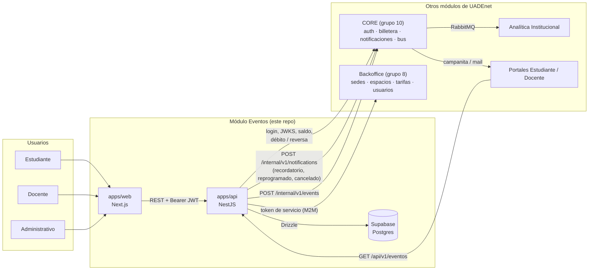
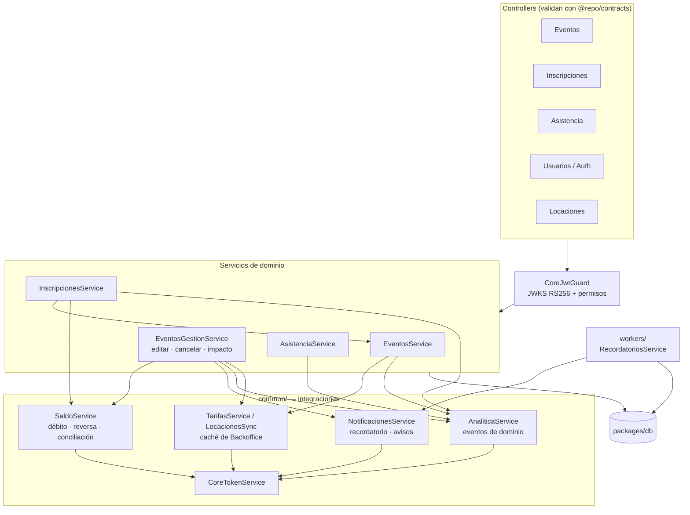
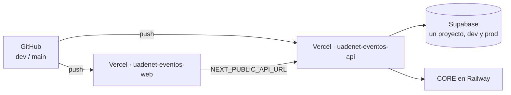

# Diagrama de arquitectura general

> Vista de conjunto del módulo Eventos Académicos dentro de UADEnet. Complementa a [`stack-y-estructura.md`](stack-y-estructura.md) (capas y carpetas) y [`flujo-de-datos-negocio.md`](flujo-de-datos-negocio.md) (secuencia de negocio). Los contratos punto por punto están en [`flujo-de-datos-integraciones.md`](flujo-de-datos-integraciones.md).

## Contexto: el módulo y los demás

Reglas de la coordinación de cátedra: identidad, billetera, avisos entre módulos y notificaciones **pasan siempre por CORE**; los pedidos de datos a su dueño (sedes, espacios, tarifas) van **directo** al módulo, con el token de servicio de CORE. Ver [`integraciones.md`](integraciones.md).

## Dentro de `apps/api`

## Despliegue

| Rama | Web | API |
|---|---|---|
| `dev` | `uadenet-eventos-web-dev.vercel.app` | `uadenet-eventos-api-dev.vercel.app` |
| `main` | `uadenet-eventos-web.vercel.app` | `uadenet-eventos-api.vercel.app` |

Dev y prod comparten la misma base (ADR 0011): una migration afecta a los dos (ver [`../04-guias/aplicar-migraciones.md`](../04-guias/aplicar-migraciones.md)). Los procesos periódicos arrancan con `setInterval` cuando la API corre como proceso largo (local). En Vercel, que es serverless, un **cron diario** (`apps/api/vercel.json`, 11:00 UTC) llama a `GET /api/v1/cron/diario`, protegido con `CRON_SECRET`, que sincroniza las locaciones y envía los recordatorios ([ADR 0016](../decisions/0016-cron-diario-de-vercel.md)). Vercel solo ejecuta crons en producción.
