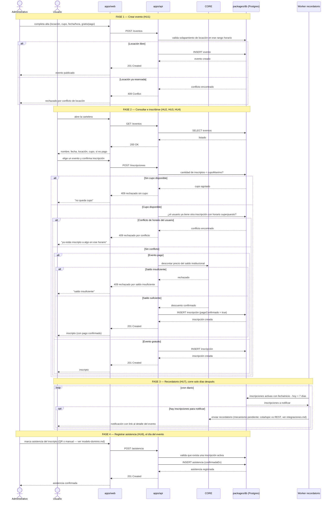
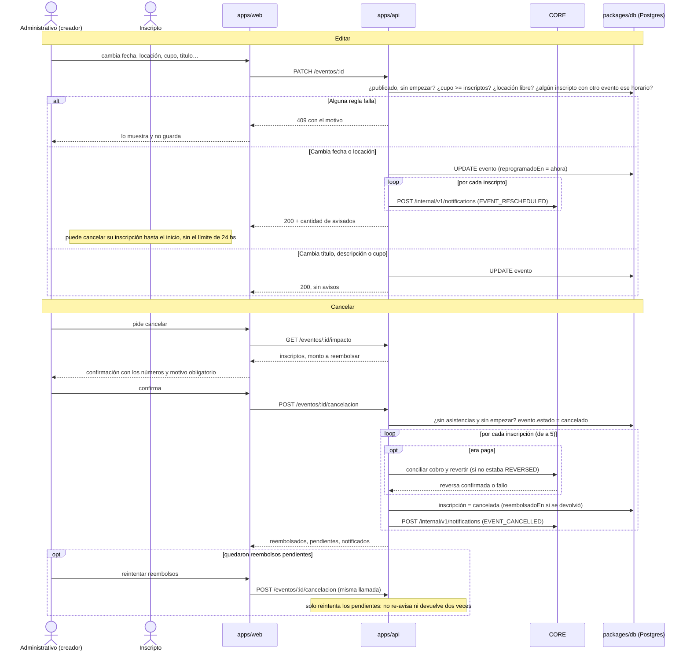

# Flujo de datos — recorrido de negocio

> Diagrama pedido en `../01-proyecto/plan-de-definicion.md` (Fase 2, punto 8) para la 1° Entrega: desde que un administrativo crea un evento hasta que un usuario se inscribe, paga (si aplica), recibe el recordatorio y se le registra la asistencia. Complementa a [`stack-y-estructura.md`](stack-y-estructura.md#flujo-de-datos), que describe las capas técnicas (web → CORE → api → db); este documento describe el recorrido de negocio en sí, con las validaciones de cada HU.

No incluye a Analítica Institucional (consume eventos nuestros, pero su contrato sigue "Pendiente" en [`integraciones.md`](integraciones.md) y no está dentro del alcance que pide `plan-de-definicion.md` para este diagrama) ni a HU5/HU8 (son consultas de lectura, no pasos de este recorrido).

Todo request a `apps/api` requiere un JWT válido de CORE (`common/guards/core-jwt.guard.ts`, firma RS256 contra el JWKS de CORE) — se omite del diagrama para no repetirlo en cada flecha. La Fase 5 (gestión del evento) se agregó después y se dibuja en un diagrama aparte, más abajo.

## Fase 5 — Gestión del evento por su creador

Pasa en cualquier momento entre la Fase 1 y el inicio del evento. Solo lo hace quien creó el evento ([ADR 0015](../decisions/0015-ciclo-de-vida-del-evento.md)).

## Notas de lectura

- Las ramas de rechazo (`alt`) son las mismas de los criterios Given/When/Then de HU1/HU3/HU4 en [`../01-proyecto/backlog.md`](../01-proyecto/backlog.md) — no son un agregado del diagrama, son la traducción visual de esos criterios.
- Fase 3 y Fase 4 pasan **días o semanas después** de la Fase 2, no en la misma sesión de usuario — el `loop`/cron de la Fase 3 y el "el día del evento" de la Fase 4 marcan ese salto en el tiempo.
- CORE aparece en varios roles según la fase: autenticación implícita en todo el diagrama, descuento de saldo en la Fase 2, envío de notificación en la Fase 3, y reembolsos y avisos en la Fase 5. Todo está implementado y probado contra el CORE simulado de `apps/api`; el estado contra el CORE real, y lo que falta confirmar, está en [`estado-integraciones-y-faltantes.md`](estado-integraciones-y-faltantes.md).
- Cancelar la propia inscripción (una persona, no el creador) no está dibujado: es el mismo circuito de reembolso de la Fase 5 para una sola inscripción, hasta 24 hs antes del inicio.
